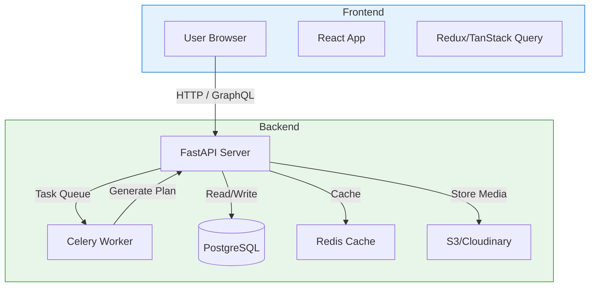
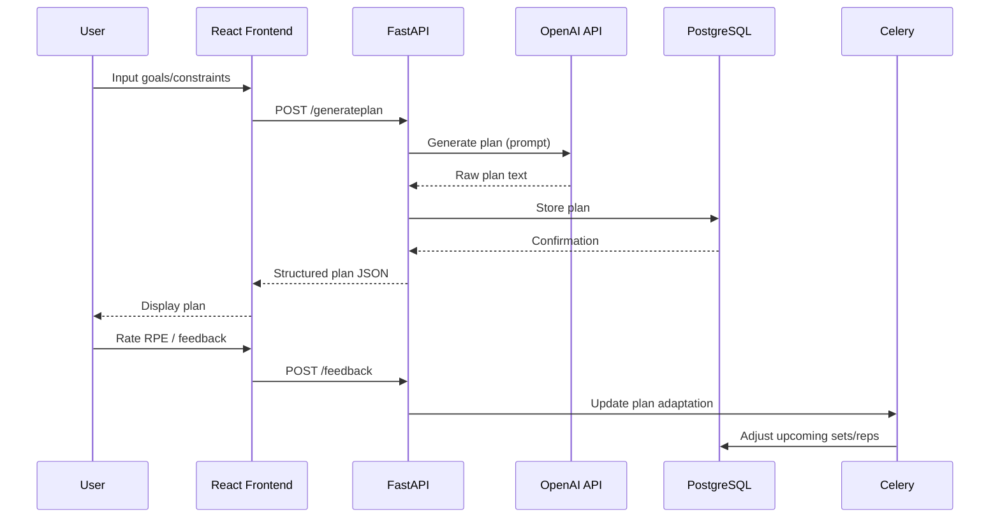

# System Architecture Overview

FitBuddy follows a **modular, microservice-oriented architecture** separated into three primary layers:

1. **Presentation Layer** (Frontend)
   - React SPA communicating via RESTful APIs or GraphQL.
   - State management with Redux Toolkit or TanStack Query.
   - Responsive UI using Tailwind CSS / Material-UI.

2. **Application Layer** (Backend API)
   - FastAPI (Python) serving as the central gateway.
   - Dependency injection, middleware for auth, logging, rate-limiting.
   - Async task queue (Celery/RQ) for AI model inference and background jobs.

3. **Data Layer**
   - PostgreSQL relational database for user profiles, plans, progress.
   - object storage (S3/Cloudinary) for exercise media.
   - Cache layer (Redis) for session data, rate limiting, frequent queries.



# Data Flow & Component Diagrams

**Plan Generation Flow**:
1. User opens app → enters goals, equipment, time → UI sends `POST /api/v1/plan/generate`.
2. FastAPI validates input → calls OpenAI API with structured prompt → receives raw workout plan.
3. Backend parses response → stores normalized plan in PostgreSQL → returns plan JSON to UI.
4. UI displays plan with exercise media from Cloudinary.
5. After each session, user rates RPE → `POST /api/v1/plan/feedback` → Celery task updates plan adjustments.



# Database Schema & Data Models

## Core Tables (ER Diagram Concept)

```mermaid
erDiagram
    USER ||--|{ PLAN : creates
    USER ||--|{ FEEDBACK : provides
    PLAN ||--|{ EXERCISE : contains
    EXERCISE ||--|{ MEDIA : has

    TABLE USER {
        int id PK
        string name
        string email UK
        string password_hash
        enum fitness_level
        date created_at
        jsonb preferences
    }

    TABLE PLAN {
        int id PK
        int user_id FK
        jsonb structure { days: [], weekly_volume }
        enum status { active, completed, archived }
        date created_at
    }

    TABLE EXERCISE {
        int id PK
        int plan_id FK
        string name
        string muscle_group
        string equipment
        int sets
        int reps
        float weight
        string demonstration_url
    }

    TABLE FEEDBACK {
        int id PK
        int user_id FK
        int plan_id FK
        int session_number
        enum rpe {1-10}
        string comments
        date recorded_at
    }

    TABLE MEDIA {
        int id PK
        string url
        string type { gif, video, image }
        string exercise_id FK
    }
```

# UI/UX Wireframe Concepts

## 1. Onboarding Wireframe
```text
+------------------------------------------+
|           WELCOME TO FIT BUDDY           |
|                                          |
|  [ ] Goal:   □ Strength   □ Weight Loss  |
|  [ ] Level:  □ Beginner  □ Intermediate |
|  [ ] Equipment: □ Dumbbells □ Barbell   |
|                                          |
|           [GET STARTED]                  |
+------------------------------------------+
```

## 2. Dashboard Wireframe
```text
+----------------------------+---------------+
|   Navigation Bar           |   Sidebar     |
|   (Home, Plans, Progress)  |   (Filters)   |
+----------------------------+---------------+
|  +------------------------+  |  Recent Plans |
|  |  Plan Card: 8-Week     |  |---------------|
|  |  Strength Program      |  |  Week 1: ...  |
|  |  [View] [Edit]         |  |  Week 2: ...  |
|  +------------------------+  |  [Add New]    |
|                              |               |
|  +------------------------+  |               |
|  |  Progress Chart (Line) |  |               |
|  |  - Strength vs Week    |  |               |
|  +------------------------+  +---------------+
+----------------------------+---------------+
```

## 3. Plan Detail Wireframe
```text
+------------------------------------------+
|  Week 1 - Day A                          |
|                                          |
|  1. Bench Press  3x5 @ 135lb              |
|     [GIF Demo]                           |
|                                          |
|  2. Rows 3x8 @ 100lb                      |
|     [GIF Demo]                           |
|                                          |
|  3. Plank 3x45s                           |
|                                          |
|  [Mark Complete] [Modify]                |
+------------------------------------------+
```

**FitBuddy USP**: An adaptable, AI-driven fitness companion that not only generates plans but evolves with the user, backed by a rich exercise media library and seamless platform integration—all within a conversational interface.