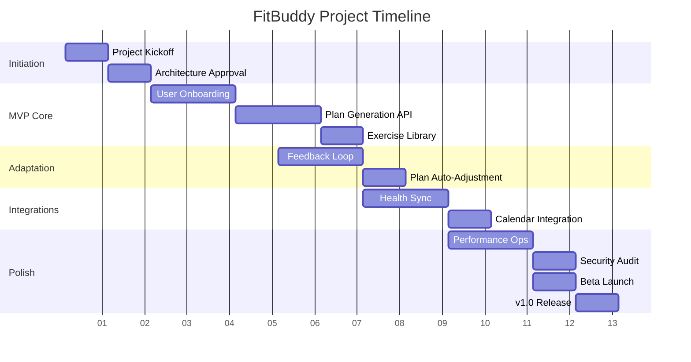

# Technology Stack Justification

| Layer | Technology | Rationale |
|-------|------------|-----------|
| **Frontend** | **React 18** + **TypeScript** | Mature ecosystem, strong typing for large codebase, excellent performance with Concurrent Rendering and Suspense. |
| | **Vite** | Fast HMR, lean build output, modern dev experience. |
| | **TanStack Query** | Server-state management, automatic caching, background refetching—reduces boilerplate. |
| | **Tailwind CSS** | Utility-first styling, rapid UI development, responsive design out-of-the-box. |
| **Backend** | **FastAPI** (Python 3.11) | Automatic OpenAPI docs, async-first, high performance (comparable to Node/Go), simple dependency injection. |
| | **Pydantic** | Data validation, settings management, automatic schema generation for API docs. |
| | **Celery + Redis** | Robust task queue for AI inference, email notifications, background data processing. |
| **Database** | **PostgreSQL 13+** | Relational integrity, JSONB support for flexible plan schemas, mature ecosystem, strong ACID guarantees. |
| **AI/ML** | **OpenAI GPT-4o / Anthropic Claude** via API | State-of-the-art natural language understanding, reliable text generation, frequent updates. |
| | **Optional: LLaMA 2** (local) | Offline fallback, cost control for high-volume usage. |
| **DevOps** | **Docker** | Containerized environments, reproducible deployments, easy scaling. |
| | **GitHub Actions** | CI/CD pipelines, automated testing, deployment to ECS/Fargate or Vercel. |
| | **AWS (ECS/Fargate or Vercel)** | Scalable hosting, managed Redis (ElastiCache), managed PostgreSQL (RDS), S3 for media. |
| **Authentication** | **OAuth 2.0** (Google, Apple) + **JWT** | Secure token-based auth, social login frictionless onboarding. |
| **Monitoring** | **Sentry** | Error tracking, performance monitoring. |
| **Analytics** | **PostHog** | Product analytics, feature usage, user journey tracking. |

# Project Milestones & Sprint Timeline

| Milestone | Description | Target Duration |
|-----------|-------------|-----------------|
| **M1: Project Initiation** | Requirements freeze, architecture approval, setup CI/CD. | 2 weeks |
| **M2: MVP Core Features** | User onboarding, plan generation, basic exercise library. | 6 weeks (2 sprints) |
| **M3: Adaptation & Feedback** | RPE-based plan adjustment, user feedback loop. | 4 weeks (1 sprint) |
| **M4: Integrations** | Apple Health / Google Fit sync, calendar integration. | 4 weeks (1 sprint) |
| **M5: Polishing & Scale** | Performance optimization, security audit, scaling setup. | 4 weeks (1 sprint) |
| **M6: Public Beta Launch** | Invite-only beta, feedback collection, final bug fixes. | 2 weeks |
| **M7: v1.0 Release** | Official launch, marketing assets, documentation. | 2 weeks |

**Sprint cadence**: 2-week sprints, Monday planning, Friday demo/retrospective.

**Gantt Chart (high-level)**:

# Risk Assessment & Mitigation Plan

| Risk | Likelihood | Impact | Mitigation Strategy |
|------|------------|--------|---------------------|
| **AI API Cost Overruns** | Medium | High | - Implement request caching, rate-limiting. - Provide fallback templated plans. - Monitor usage via OpenAI billing alerts. |
| **Low User Adoption** | Medium | Medium | - Early beta with targeted fitness communities. - Incentivize referrals, provide free tier with core features. - Collect NPS regularly. |
| **Data Privacy Compliance (GDPR, HIPAA)** | Low | High | - Data minimization, explicit consent flows. - Anonymize analytics. - Consult legal for health-data handling. |
| **Performance Degradation under Load** | Medium | Medium | - Stateless API design, horizontal scaling. - Redis caching for frequent queries. - Load testing with k6 before launch. |
| **Third-Party API Changes (OpenAI, Apple Health)** | Low | Medium | - Abstract API calls behind service interfaces. - Maintain versioning; implement fallback prompts. - Monitor changelogs, subscribe to developer newsletters. |
| **Talent Acquisition** | Low | High | - Partner with university CS programs. - Offer open-source contributions as attractor. - Remote-first hiring policy. |

**Contingency Budget**: 15% of total project budget allocated for unexpected AI API cost overruns or extended compliance consulting.